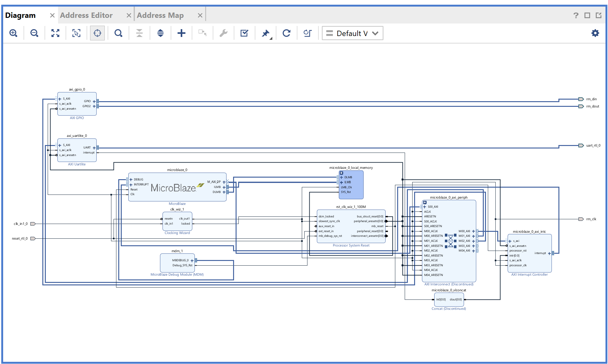
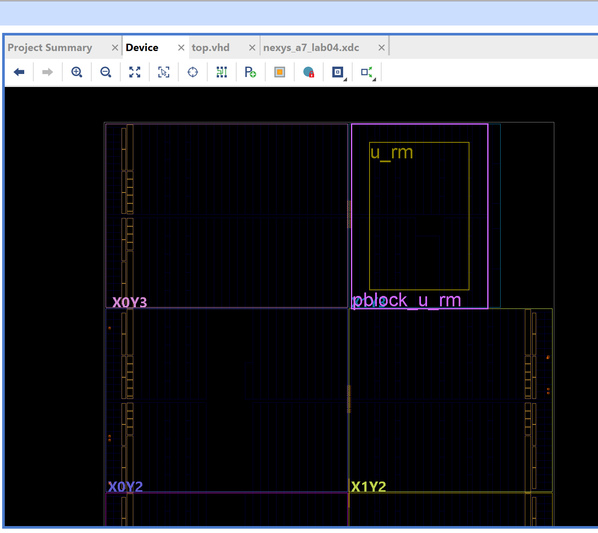
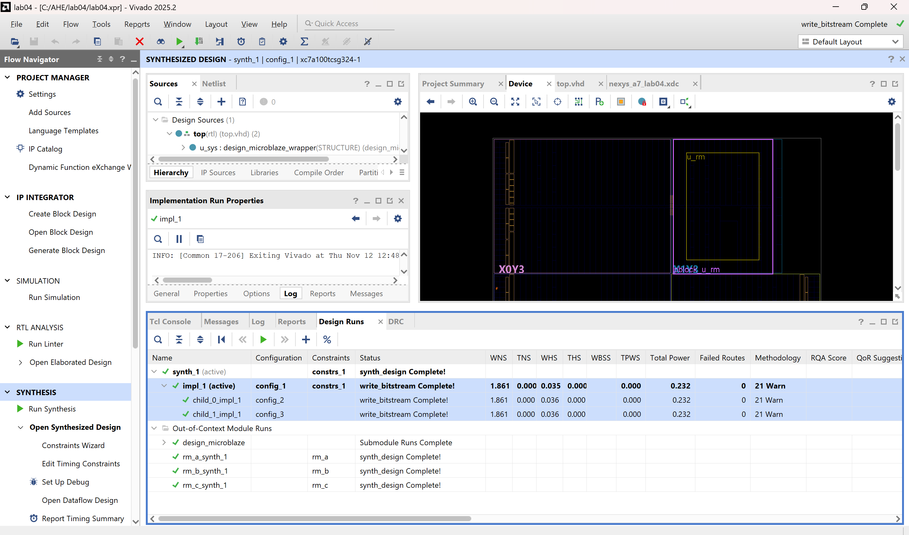
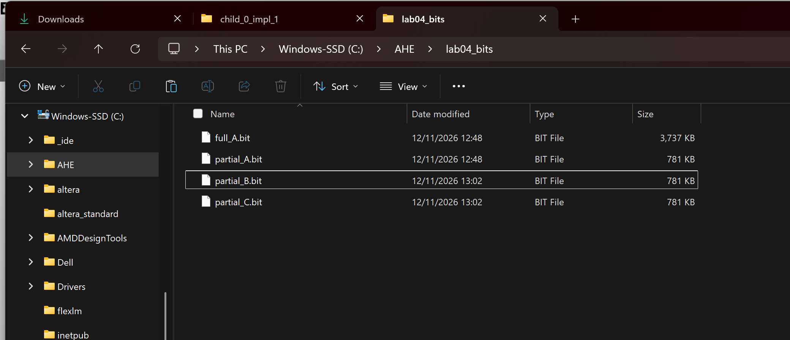
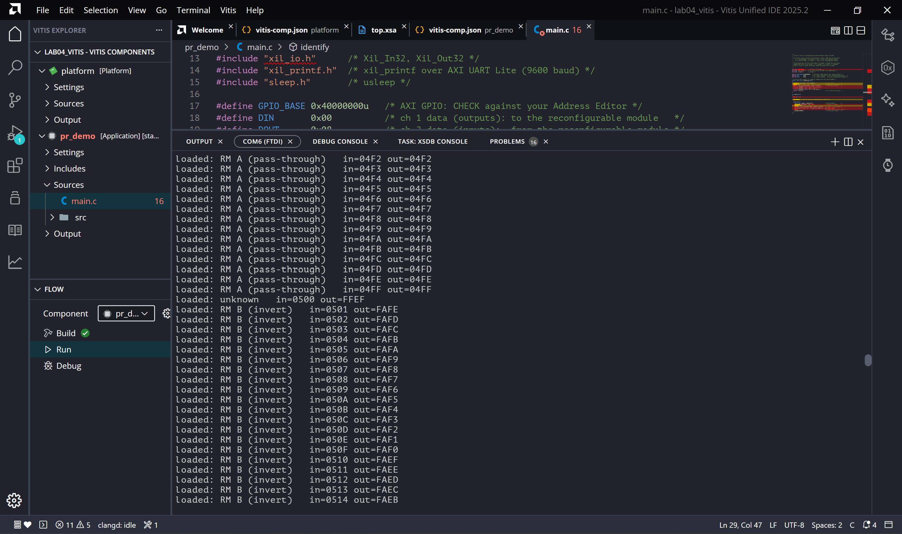
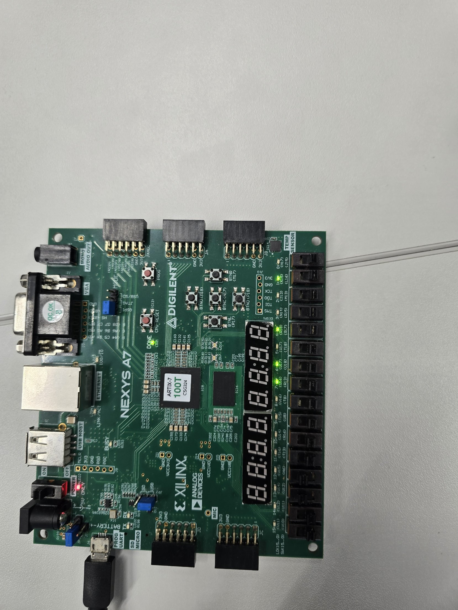
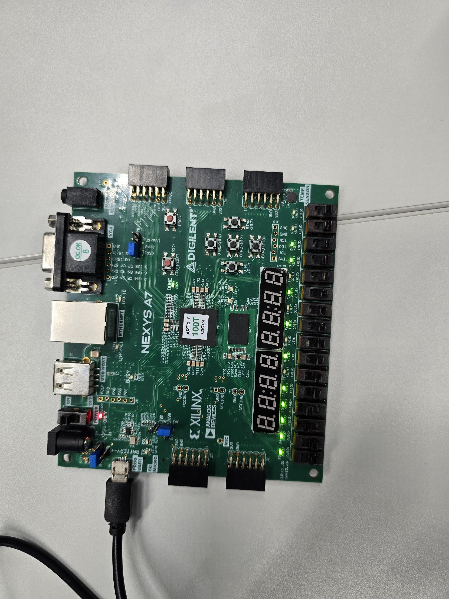
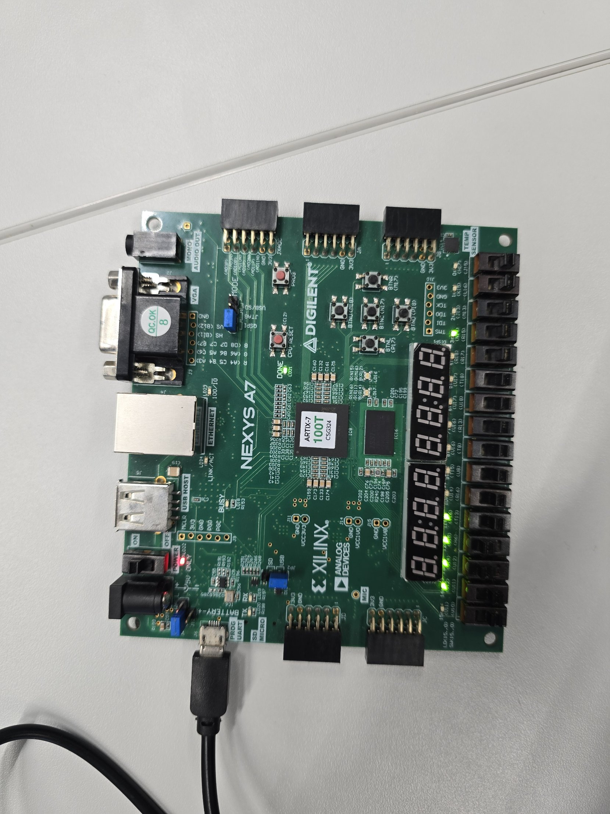

# Lab 04 – Partial Reconfiguration (DFX) with MicroBlaze

WS-2026 Advanced Hardware Engineering · Hochschule Hamm-Lippstadt
Board: Nexys A7-100T (xc7a100tcsg324-1) · Tools: Vivado 2025.2 / Vitis Unified IDE 2025.2

The FPGA is divided into a **static region** (MicroBlaze system) and one **reconfigurable partition**. A small 16-bit module in the partition is exchanged at run time by loading a **partial bitstream**, while the MicroBlaze keeps running and reports over the UART which module is loaded.

## Results

| Result | Value |
|---|---|
| Demo | Modules A → B → C → A swapped while the MicroBlaze kept running ✔ |
| Bitstreams | Full 3,825,904 B · each partial 799,693 B (20.9 % of the full) |
| Timing at 100 MHz | Met in all three configurations – WNS 1.861 ns, WHS 0.035 ns |
| Utilization | 1,634–1,650 LUTs (2.6 %) · 1,764 FFs (1.4 %) · 32 BRAM (23.7 %) · 20 IOB |
| Power | 0.232 W total on-chip |
| Verification | Full-cycle log: counter continuous 0x0000–0x014F, 0 wrong outputs |

## Repository structure

```
Lab_Task_04/
├── README.md
├── .gitignore
├── src/            top.vhd, rm_a.vhd, rm_b.vhd, rm_c.vhd, nexys_a7_lab04.xdc (with Pblock)
├── vivado/         lab04.xpr, block design (.bd + .xci), top.xsa
├── vitis/          main.c (application pr_demo)
├── bitstreams/     full_A.bit, partial_A.bit, partial_B.bit, partial_C.bit
├── screenshots/    block design, floorplan, design runs, bitstream sizes, terminal
├── logs/           serial terminal output of all swaps
├── demo/           board photos
└── Final Summary/  Lab_04_Summary.pdf
```

## Design

A VHDL top level (`src/top.vhd`) instantiates the block design as `u_sys` (static region) and the reconfigurable module as `u_rm`. One AXI GPIO connects the two: channel 1 (offset 0x00, 16 outputs) drives `din`, channel 2 (offset 0x08, 16 inputs) reads `dout`. The module output also drives LD0–LD15.



### Reconfigurable modules

All three have the same ports (`clk`, `din[15:0]`, `dout[15:0]`) and register the output on `rising_edge(clk)`.

| Module | Function | Answer to test value 0x0001 | Logic |
|---|---|---|---|
| rm_a | `dout <= din;` – pass-through | 0x0001 | 16 FF, 0 LUT |
| rm_b | `dout <= not din;` – invert | 0xFFFE | 16 FF, 16 LUT |
| rm_c | `dout <= din(7 downto 0) & din(15 downto 8);` – swap bytes | 0x0100 | 16 FF, 0 LUT |

### Address map

| Peripheral | Base address | Use |
|---|---|---|
| axi_gpio_0 | 0x4000_0000 | din (0x00), dout (0x08) |
| axi_uartlite_0 | 0x4060_0000 | xil_printf, 9600 baud |
| microblaze_0_axi_intc | 0x4120_0000 | not used |
| Local memory | 0x0000_0000 | 128 KB code and data |

### DFX set-up and floorplan

- Partition definition `rm_pd` on `u_rm`; modules rm_a, rm_b, rm_c.
- Configurations: config_1 = rm_a, config_2 = rm_b, config_3 = rm_c.
- Runs: parent `impl_1` and children `child_0_impl_1`, `child_1_impl_1`, which reuse the locked static region.
- Pblock `pblock_u_rm` in clock region X1Y3, full height Y150–Y199: `SLICE_X52Y150:SLICE_X81Y199`, 40 DSP48, 20 RAMB36 / 40 RAMB18, `PCIE_X0Y0` (required by DRC HDPR-45). `RESET_AFTER_RECONFIG` and `SNAPPING_MODE ON` are set.





### Implementation results

| Run | Module | LUTs | Registers | WNS | WHS | Power |
|---|---|---|---|---|---|---|
| impl_1 (config_1) | rm_a | 1,634 | 1,764 | 1.861 ns | 0.035 ns | 0.232 W |
| child_0_impl_1 (config_2) | rm_b | 1,650 | 1,764 | 1.861 ns | 0.036 ns | 0.232 W |
| child_1_impl_1 (config_3) | rm_c | 1,634 | 1,764 | 1.861 ns | 0.036 ns | 0.232 W |

The static region (1,634 LUTs, 1,748 registers) and its timing are identical in all three runs.

## Bitstreams

| File | Generated by | Size (bytes) | Share | Configures |
|---|---|---|---|---|
| full_A.bit | impl_1 | 3,825,904 | 100 % | whole device: static region + rm_a |
| partial_A.bit | impl_1 | 799,693 | 20.9 % | Pblock only: rm_a |
| partial_B.bit | child_0_impl_1 | 799,693 | 20.9 % | Pblock only: rm_b |
| partial_C.bit | child_1_impl_1 | 799,693 | 20.9 % | Pblock only: rm_c |



## Software

`vitis/main.c` (application `pr_demo`, bare-metal). It sends the test value 0x0001 to find out which module is loaded, then sends a 16-bit counter and prints input and output four times per second. The counter is never reset, so a processor restart would be visible in the log.

## Demonstration

1. Hardware Manager → Program Device with `full_A.bit`; start `pr_demo` from Vitis; serial monitor COM6, 9600 baud.
2. With the program running, load `partial_B.bit`, then `partial_C.bit`, then `partial_A.bit`.

Excerpt from `logs/log_full_cycle_A_B_C_A.txt`:

```
loaded: RM A (pass-through)   in=004A out=004A
loaded: unknown   in=004B out=4CCE            <- partial_B.bit being loaded
loaded: unknown   in=004C out=FFCF
loaded: RM B (invert)   in=004D out=FFB2
...
loaded: RM B (invert)   in=00A8 out=FF57
loaded: unknown   in=00A9 out=FFF7            <- partial_C.bit being loaded
loaded: unknown   in=00AA out=D7FF
loaded: RM C (swap bytes)   in=00AB out=AB00
...
loaded: RM C (swap bytes)   in=00FD out=FD00
loaded: unknown   in=00FE out=FDF7            <- partial_A.bit being loaded
loaded: RM A (pass-through)   in=00FF out=00FF
```

| Log | Lines | Counter | Swaps | Wrong outputs |
|---|---|---|---|---|
| log_A_only.txt | 337 | continuous | – | 0 |
| log_A_to_B.txt | 415 | continuous | A → B | 0 |
| log_A_B_C.txt | 1,034 | 0x04CD – 0x08D6 | A → B → C | 0 |
| log_full_cycle_A_B_C_A.txt | 336 | 0x0000 – 0x014F | A → B → C → A | 0 |



| RM A | RM B | RM C |
|---|---|---|
|  |  |  |
| LEDs show the counter | inverted counter | counter in the upper byte |

## Answers to the questions of Task 4

**How large is the full bitstream and how large are the partial ones?**
The full bitstream is 3,825,904 bytes (about 3.65 MB). Each partial bitstream is 799,693 bytes (about 781 KB), 20.9 % of the full one. A partial bitstream only contains the configuration frames of the Pblock, not the whole device.

**Why do the three partial bitstreams have the same size?**
All three use the same Pblock, so they write the same set of configuration frames. Every frame inside the rectangle is written, also the frames a module does not use. The size depends only on the Pblock area, not on the logic. The contents and checksums differ.

**What happened to the terminal output during the swap?**
The program kept printing and the counter kept counting; no line was lost and nothing restarted. For 1–2 lines per swap the module was reported as `unknown` with mixed values such as 0x4CCE: while the frames are being written, the outputs of the partition are undefined. With about 0.3 s per loop, the swap over JTAG took roughly 0.3–0.6 s. The next line already showed the new module working correctly. A DFX Decoupler would hold the interface at a defined value during this time.

**Why was the MicroBlaze not affected?**
The MicroBlaze, its memory, the UART, the GPIO and the clocking lie in the static region, outside the Pblock. A partial bitstream only writes frames inside the Pblock, so the processor's configuration is never touched and its registers and memory keep their values. The identical static utilization and timing of all three runs show that the static region was locked and reused. (One processor halt during testing came from the Vitis debugger and the Hardware Manager sharing the JTAG cable, not from the reconfiguration.)

**When would you not use reconfiguration?**
- When all functions fit into the device at the same time – a multiplexer with a select register would be smaller and switch in one clock cycle.
- When switching must be fast – a swap takes about 0.3 s over JTAG and still milliseconds with ICAP.
- When the outputs must never be undefined, unless a decoupler is added.
- When the area overhead is too high – the Pblock reserves 1,500 slices plus BRAM, DSP and PCIE sites for a module that uses 16 flip-flops.
- When the extra effort does not pay off – floorplanning, DRC fixes, one run per configuration and testing every combination.

## Summary

- **Static region:** the part that never changes – MicroBlaze, local memory, UART, GPIO, clock and reset. Configured once with the full bitstream, implemented once in the parent run and locked; it keeps running during every swap.
- **Reconfigurable partition:** a reserved area (`pblock_u_rm`, clock region X1Y3) with a fixed interface (`clk`, `din[15:0]`, `dout[15:0]`). It defines where a module may be placed and which frames a partial bitstream rewrites.
- **Reconfigurable modules:** designs with identical ports that can occupy the partition – rm_a (pass-through), rm_b (invert), rm_c (swap bytes). Each is implemented in its own configuration against the same static region.
- **Partial bitstreams:** files that rewrite only the frames of the partition (799,693 B instead of 3,825,904 B). Loading one at run time changes the hardware function without stopping the processor.

The full report is in [`Final Summary/Lab_04_Summary.pdf`](Final%20Summary/Lab_04_Summary.pdf).
