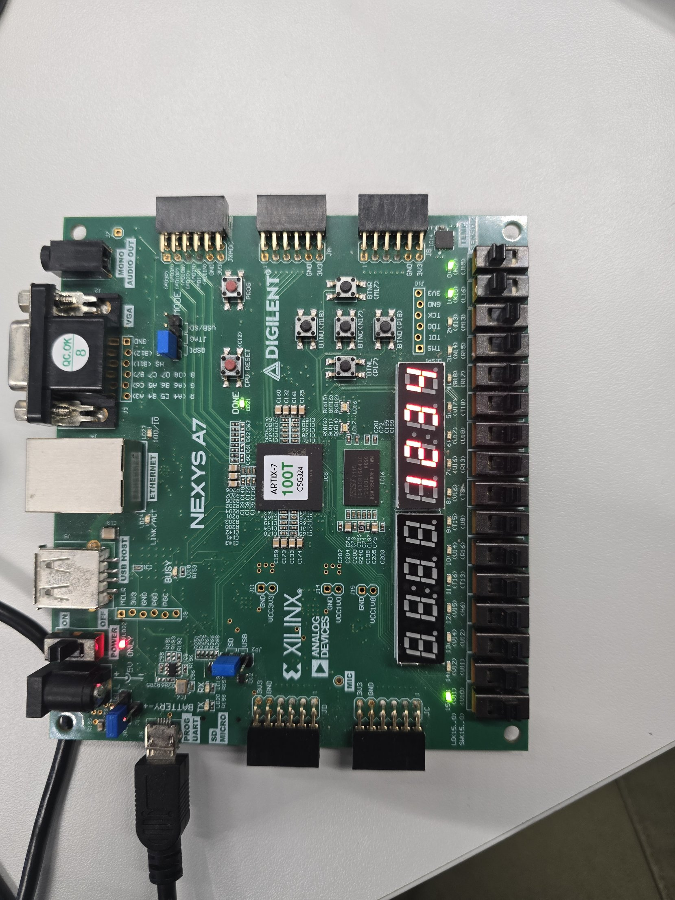
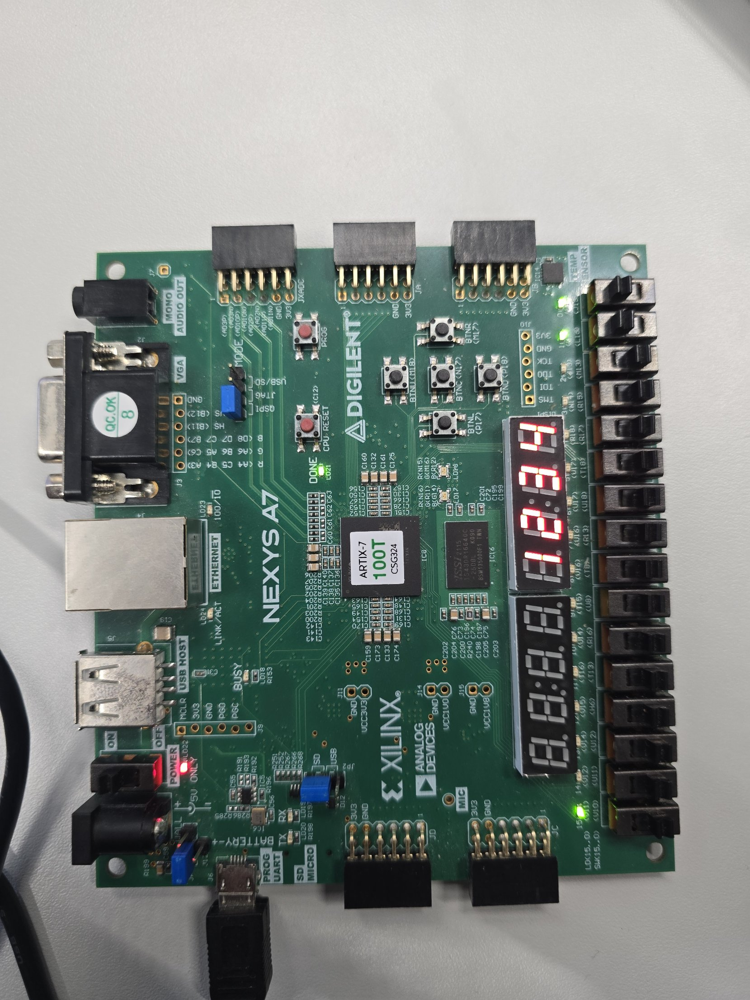
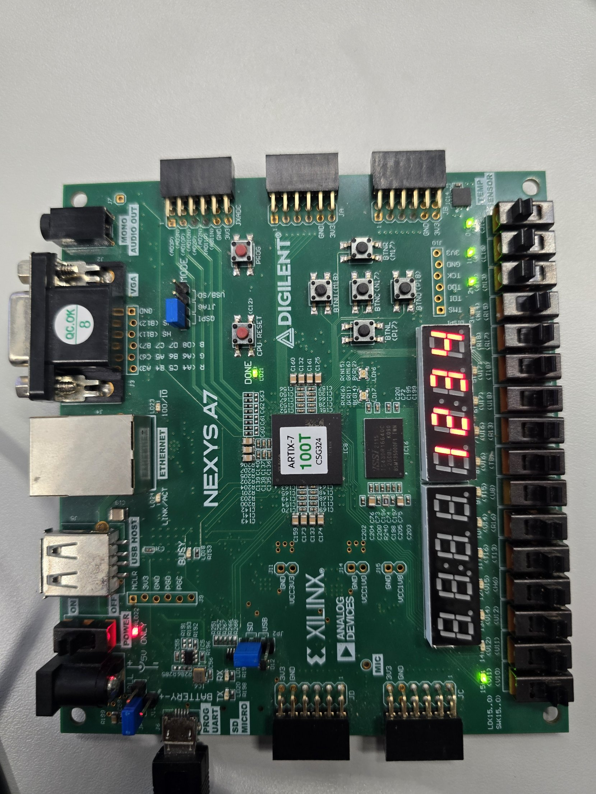

# Lab 05 – FreeRTOS I/O Controller on MicroBlaze with DDR2

WS-2026 Advanced Hardware Engineering · Hochschule Hamm-Lippstadt
Board: Nexys A7-100T (xc7a100tcsg324-1) · Tools: Vivado 2025.2 / Vitis Unified IDE 2025.2

A MicroBlaze with instruction and data caches runs **FreeRTOS** from **128 MiB DDR2**. Five tasks and one software timer read the switches, multiplex the 7-segment display, log switch events into a ring buffer in DDR2 and answer commands in a UART shell.

## Results

| Result | Value |
|---|---|
| Timing at 100 MHz | Met – WNS 1.316 ns, WHS 0.019 ns, WPWS 0.206 ns, 0 failing endpoints |
| Program location | `.text` at **0x80000000** (DDR2); only the vectors (0x00–0x27) in local memory |
| FreeRTOS tick | 1 ms: `rtos_hello` printed 363 lines exactly **500 ticks** apart (181 s, no error) |
| Shell | `help`, `sw`, `seg`, `led`, `mirror`, `log`, `stats`, `monitor` all work (PuTTY, COM7, 9600 8N1) |
| Heap | 2 MiB; 1,560,912 B free, minimum equal → no allocation after start-up |
| Event log | 16 switch events stored in DDR2, every tick a multiple of 20 (20 ms sampling) |

## Repository structure

```
Lab_Task_05/
├── README.md
├── .gitignore
├── hardware/       project_1.xpr, block design (system.bd + ip/*.xci), drc.xdc, system.xsa, system_wrapper.bit
├── software/       rtos_hello.c (Part B), rtos_app.c (Part C, changes marked)
├── screenshots/    block design, Address Editor, timing, platform/app builds, PuTTY session
├── logs/           rtos_hello terminal, mb-objdump, rtos_app shell sessions
└── demo/           board photos and the two videos
```

## Part A – Hardware (Vivado)


- MicroBlaze (classic), 64 KB local memory, **8 KB I-cache and 8 KB D-cache**, debug module, peripheral AXI port.
- **DDR2** (MIG 7-series, board interface) behind an AXI SmartConnect on the cache ports `M_AXI_DC` / `M_AXI_IC`; the MIG runs its own 81 MHz `ui_clk` domain with its own reset block.
- **One Clocking Wizard** (board `sys_clock`, active-low board `reset`): clk_out1 = 100 MHz → MicroBlaze, peripherals and MIG `sys_clk_i`; clk_out2 = 200 MHz → MIG `clk_ref_i`. MIG `sys_rst` polarity ACTIVE_LOW.
- **AXI Timer → AXI Interrupt Controller → MicroBlaze INTERRUPT** (FreeRTOS tick).
- AXI UART Lite (`usb_uart`, 9600 baud); GPIO 0 = `dip_switches_16bits` (ch 1) + `led_16bits` (ch 2); GPIO 1 = `dual_seven_seg_led_disp` (ch 1, segments) + `seven_seg_led_an` (ch 2, anodes).
- All pins come from board interfaces: no pin XDC. Only `drc.xdc`: `set_property SEVERITY {Warning} [get_drc_checks RTRES-1]`.
- VHDL wrapper `system_wrapper.vhd` (target language VHDL), managed by Vivado.

### Address map


| Block | Base | Range |
|---|---|---|
| axi_gpio_0 (switches, LEDs) | 0x4000_0000 | 64K |
| axi_gpio_1 (7-segment) | 0x4001_0000 | 64K |
| axi_uartlite_0 | 0x4060_0000 | 64K |
| axi_intc_0 | 0x4120_0000 | 64K |
| axi_timer_0 | 0x41C0_0000 | 64K |
| local memory (I + D) | 0x0000_0000 | 64K |
| mig_7series_0 (DDR2) | 0x8000_0000 | 128M |

The addresses match the defaults in both C files, so no address had to be changed.

### Timing


All user-specified timing constraints are met (WNS 1.316 ns, WHS 0.019 ns). The 87 methodology warnings come from the unconstrained slow board I/O and the 100 MHz ↔ 81 MHz crossings handled inside the SmartConnect and reset IP.

## Part B – FreeRTOS platform (Vitis)

Platform `rtos_platform` from `system.xsa`, OS **freertos**, processor microblaze_0.

| Setting | Value |
|---|---|
| freertos_tick_rate | **1000** (default 100) |
| freertos_total_heap_size | **2097152** (0x200000 = 2 MiB, default 65536) |
| freertos_use_timers / use_mutexes | true |
| freertos_check_for_stack_overflow | 2 |
| freertos_stdin / stdout | axi_uartlite_0 |
| XILTIMER_tick_timer | axi_timer_0 |

### Memory placement (`mb-objdump -h rtos_hello.elf`)

| Section | VMA | Size |
|---|---|---|
| .vectors.reset / sw_exception / interrupt / hw_exception | 0x00 / 0x08 / 0x10 / 0x20 | 8 B each |
| .text | **0x80000000** | 0x6EF4 |
| .rodata, .data | 0x80007138, 0x80007BF0 | 0xAB8, 0x5A |
| .bss (contains the 2 MiB FreeRTOS heap) | 0x80007C50 | 0x2004F0 |
| .heap, .stack (C start-up only) | 0x80208140, 0x80208940 | 0x800, 0x400 |

Full output: [`logs/02_mb_objdump_rtos_hello.txt`](logs/02_mb_objdump_rtos_hello.txt).

### rtos_hello

```
FreeRTOS hello
received 0 at tick 0
received 1 at tick 500
received 2 at tick 1000
...
received 362 at tick 181000
```

All 363 lines checked: counter continuous, tick difference always exactly 500. LD0 blinks every 250 ms (photos 01/02, video 1).

## Part C – I/O controller (`rtos_app.c`)

| Task / timer | Priority | Stack (words) | Job |
|---|---|---|---|
| input | 3 | 256 | samples the switches every 20 ms (`vTaskDelayUntil`), sends changes to the queue, mirrors them to LD0–LD14 |
| display | 3 | 256 | multiplexes the right four digits, 2 ms per digit |
| logger | 2 | 256 | writes queue events into a 65,536-entry ring buffer (512 KiB) in DDR2 |
| shell | 2 | 768 | UART command line |
| monitor | 1 | 512 | prints `stats` every 5 s when `monitor on` |
| heartbeat (software timer) | timer task | – | toggles LD15 every 500 ms |

`xil_printf` is protected by a mutex (`PRINT` macro); the LED register by a critical section.

### Changes to the given code (marked `CHANGED` in the file)

1. **print_stats:** the Vitis 2025.2 FreeRTOS platform has no option for `INCLUDE_uxTaskGetStackHighWaterMark`, so `stats` printed "n/a". The stack marks are now read with `uxTaskGetSystemState()`, which is available because `freertos_use_trace_facility = true`.
2. Addresses checked against the Address Editor: unchanged. The two hook functions did not collide with the BSP and were kept.

### Shell session (excerpt, full log in `logs/04_rtos_app_session2_final.txt`)

```
> help
help | led <hex> | sw | seg <hex> | mirror on/off | log [clear] | stats | monitor on/off
> sw
switches: 0003
> seg 1234
> log
tick 538680: switches 0003
tick 523940: switches 0007
tick 519600: switches 0003
tick 514720: switches 0001
tick 508580: switches 0000
...
16 entries in total
> stats
uptime 647679 ticks, heap free 1560912 bytes (minimum 1560912), log 16 entries
stack free (words): shell 623 IDLE 161 input 207 Tmr Svc 349 monitor 402 display 220 logger 200
```


| `seg 1234` | Mirror: SW0+SW1 | Mirror: SW0+SW1+SW2 |
|---|---|---|
|  |  |  |

### Measured stack use (final `stats`)

| Task | Size | Free | Used |
|---|---|---|---|
| input | 256 | 207 | 49 |
| display | 256 | 220 | 36 |
| logger | 256 | **200** | 56 |
| shell | 768 | 623 | 145 |
| monitor | 512 | 402 | 110 |
| IDLE (kernel) | 200 | **161** | 39 |
| Tmr Svc (kernel) | – | 349 | – |

## Answers to the questions

**Why tick_rate 1000?**
All FreeRTOS delays are whole ticks. `display_task` waits 2 ms per digit (8 ms for four digits = 125 Hz, flicker-free). At 100 Hz, `pdMS_TO_TICKS(2)` = 0, so `vTaskDelay(0)` would not block: the priority-3 display task would run continuously and starve logger, shell and monitor. The code therefore has an `#error` for tick rates below 1000. The 20 ms switch sampling and 10 ms UART polling also need 1 ms resolution. Measured: 500 ticks per 500 ms in `rtos_hello`, and every logged switch event at a multiple of 20 ticks. Cost: 1,000 tick interrupts per second, small at 100 MHz.

**Which task has the least free stack?**
Of the application tasks, **logger**: 200 of 256 words free (78 %). Counting kernel tasks, **IDLE** is lowest at 161 words. The biggest user is **monitor** (110 words), because `print_stats` calls `xil_printf` with many arguments; before the first automatic print it still had 478 words free. High-water marks only show the deepest point reached so far, so they were read after all commands had been used. All values are far from zero; the 768-word shell stack could be reduced.

**What changes if display_task gets priority 1?**
It would be below shell and logger (2) and input (3), and equal to monitor. `xil_printf` busy-waits on the UART at 9600 baud (about 1 ms per character). One `stats` output takes about **166 ms**, which is why the monitor period measured **5,166 ticks** instead of 5,000. While the shell prints, it is always ready, so a priority-1 display task would not run: multiplexing stops, one digit stays lit and the others go dark, and the display visibly blinks on every `help`, `log` or `stats`. With priority 3 the display preempts the printing shell every 2 ms and stays steady, as the photos taken while typing show.

## Videos

- `demo/video_1_rtos_hello_LD0_blink.mp4` – Part B, LD0 blinking
- `demo/video_2_rtos_app_display_LD15.mp4` – Part C, display and LD15 heartbeat

## Problems and solutions

| Problem | Solution |
|---|---|
| DDR2 drag-and-drop created external ports `sys_clk_i`, `clk_ref_i` | Deleted; MIG clocked from clk_wiz_1 (100 MHz + 200 MHz) |
| Board serial port changed from COM6 to COM7 | Used COM7 everywhere |
| Vitis serial monitor did not send typed characters | PuTTY (Serial, COM7, 9600, flow control none) for the shell |
| `stats` printed "n/a" for the stacks | `uxTaskGetSystemState()` (see Changes) |
| Run refused: debug session still open | Old sessions terminated in Run and Debug (■), then Run |
| Debug launch stopped at `main` | Continue (▷\|), or use Run instead of Debug |
